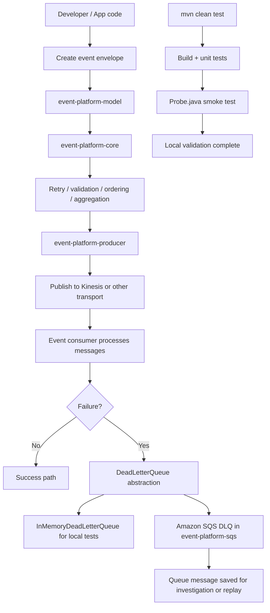

# Event Platform SDK

## Architecture overview

The SDK is organized into a small set of reusable modules:

- `event-platform-model`: event envelope and metadata contracts.
- `event-platform-core`: retry logic, DLQ abstraction, state tracking, ordering, aggregation, and validation.
- `event-platform-producer`: publishing side and event creation helpers.
- `event-platform-consumer`: consumer abstraction.
- `event-platform-kinesis`: AWS integrations, including the SQS-backed dead-letter queue implementation.

The event-driven core is intentionally interface-based. The generic DLQ contract lives in the core module so application code depends on the abstraction, not the specific infrastructure implementation.

## Dead-letter queue design

The core contract is defined in `DeadLetterQueue` and implemented by `InMemoryDeadLetterQueue` for local development and tests. Production wiring should use `SqsDeadLetterQueue`, which performs the same abstraction but sends failed records to Amazon SQS.

`DeadLetterRecord` preserves the core metadata needed for investigations:

- event identifier
- event type
- error code
- message text
- timestamp
- payload (when available)
- correlation identifier
- exception type
- stack trace details

## AWS SQS configuration

The SQS-specific implementation uses the standard AWS SDK v2 credential chain (`DefaultCredentialsProvider`), so IAM roles, environment variables, shared credentials files, or other credential sources can be used without hard-coded credentials.

Set the following configuration values:

### Environment variables

```bash
AWS_REGION=us-east-1
AWS_DEFAULT_REGION=us-east-1
EVENT_PLATFORM_SQS_QUEUE_URL=https://sqs.us-east-1.amazonaws.com/123456789012/event-platform-dlq
EVENT_PLATFORM_SQS_VISIBILITY_TIMEOUT_SECONDS=30
EVENT_PLATFORM_SQS_MAX_RECEIVE_COUNT=5
```

For LocalStack, use the service endpoint instead of the AWS public endpoint:

```bash
AWS_REGION=us-east-1
AWS_ENDPOINT_URL=http://localhost:4566
EVENT_PLATFORM_SQS_QUEUE_URL=http://localhost:4566/000000000000/event-platform-dlq
```

### Endpoint format

- AWS SQS URL: `https://sqs.<region>.amazonaws.com/<account-id>/<queue-name>`
- LocalStack SQS URL: `http://localhost:4566/000000000000/<queue-name>`

### Properties

The queue properties can also be created programmatically by using `SqsDeadLetterQueueProperties`:

```java
SqsDeadLetterQueueProperties properties = new SqsDeadLetterQueueProperties(
        "us-east-1",
        "https://sqs.us-east-1.amazonaws.com/123456789012/event-platform-dlq",
        Duration.ofSeconds(30),
        5
);

SqsDeadLetterQueue queue = SqsDeadLetterQueue.fromProperties(properties);
```

## Message lifecycle

When a failure is classified as a DLQ-worthy event:

1. The application creates or enriches a `DeadLetterRecord`.
2. `SqsDeadLetterQueue.enqueue(...)` serializes it to JSON and sends the message to SQS.
3. SQS stores the message until it is processed or the queue redrive policy triggers.
4. `receive()` retrieves the next message and deletes it after processing.
5. `delete(String eventId)` can be used to remove a specific message explicitly.
6. `find(...)` and `all()` support lookup of queued records without changing the core retry behavior.

The AWS queue redrive policy should be managed at the queue or source queue configuration level. `SqsDeadLetterQueueProperties.redrivePolicy(...)` produces the value used by the AWS source queue when a queue is configured for DLQ redrives.

## Deployment and local development

For local development, the in-memory queue remains available for tests and isolated use cases:

```java
DeadLetterQueue queue = new InMemoryDeadLetterQueue();
```

For production or cloud deployments, prefer:

```java
DeadLetterQueue queue = SqsDeadLetterQueue.fromEnvironment();
```

When running in AWS, grant the runtime identity permission to send and receive messages from the DLQ. A practical IAM policy includes `sqs:SendMessage`, `sqs:ReceiveMessage`, and `sqs:DeleteMessage` on the relevant queue ARN.

## SQS payload example

The queue stores a JSON-serialized `DeadLetterRecord`.

```json
{
  "eventId": "evt-123",
  "eventType": "user.created",
  "errorCode": "EVENT_UNKNOWN_FAILURE",
  "message": "invalid event payload",
  "createdAt": "2026-11-08T12:00:00Z",
  "payload": "{\"userId\":\"123\"}",
  "correlationId": "corr-9",
  "exceptionType": "IllegalArgumentException",
  "stackTrace": "java.lang.IllegalArgumentException: invalid event payload"
}
```

Example LocalStack send command:

```bash
aws --endpoint-url=http://localhost:4566 sqs send-message \
  --queue-url http://localhost:4566/000000000000/event-platform-dlq \
  --message-body '{"eventId":"evt-123","eventType":"user.created","errorCode":"EVENT_UNKNOWN_FAILURE","message":"invalid event payload","createdAt":"2026-11-08T12:00:00Z","payload":"{\"userId\":\"123\"}","correlationId":"corr-9","exceptionType":"IllegalArgumentException","stackTrace":"java.lang.IllegalArgumentException: invalid event payload"}'
```

## End-to-end flow



## Run flow

1. Build and test the entire project:

```bash
cd D:\GenAi-Projects\event-platform-sdk_ws
mvn clean test
```

2. Run the sample smoke test entry point:

```bash
cd D:\GenAi-Projects\event-platform-sdk_ws
mvn -q -DskipTests compile
javac Probe.java
java Probe
```

3. If AWS infrastructure is required, create the queue/table resources before running services that talk to AWS.

4. Use the SQS-backed dead-letter queue for production or cloud deployments and keep the in-memory queue for tests and local development.

## Dry Run

The Kinesis module contains SQS-specific unit tests covering:

- successful enqueue
- receive and delete lifecycle
- serialization compatibility
- failure handling for AWS communication errors

The project also retains the core domain-level unit test for ordering, validation, retry decisions, and state tracking.
