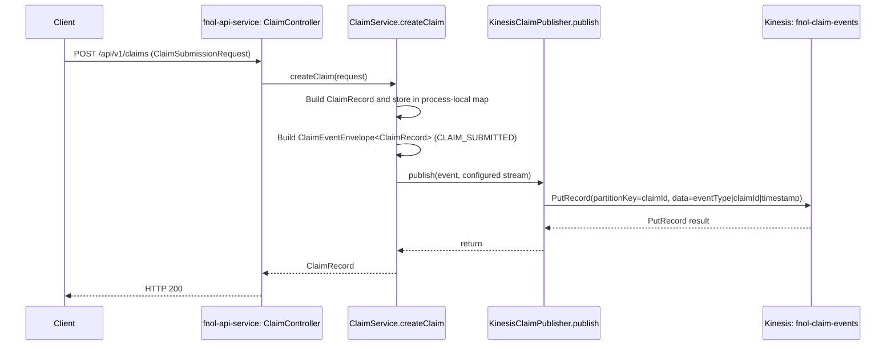

# AWS Kinesis Flow Analysis

## Confirmed application flow



### Source trace

1. `fnol-api-service/src/main/java/com/fnol/api/controller/ClaimController.java`, `submitClaim`, handles `POST /api/v1/claims`.
2. `fnol-api-service/src/main/java/com/fnol/api/service/ClaimService.java`, `createClaim`, makes a `ClaimRecord`, places it in `claims`, builds a `ClaimEventEnvelope<ClaimRecord>`, stores it in `claimEvents`, and invokes `KinesisClaimPublisher.publish`.
3. `fnol-api-service/src/main/java/com/fnol/api/service/KinesisClaimPublisher.java`, `publish`, builds AWS SDK v2 `PutRecordRequest` and calls `KinesisClient.putRecord`.
4. `fnol-api-service/src/main/java/com/fnol/api/config/KinesisProperties.java` and `fnol-api-service/src/main/resources/application.yml` define `aws.kinesis.fnol-claim-events-stream`, defaulting to `fnol-claim-events` and overridable with `KINESIS_STREAM_FNOL`.
5. `fnol-api-service/src/main/java/com/fnol/api/config/AwsConfiguration.java` provides the synchronous Kinesis client using `AWS_REGION` (default `us-east-1`), `DefaultCredentialsProvider`, and optional `AWS_ENDPOINT_URL`.

The `CLAIM_SUBMITTED` event's in-memory envelope has a generated `eventId`, version `1.0`, source `fnol-api-service`, timestamp, claim ID, and a `ClaimRecord` payload. It is **not** JSON encoded by `KinesisClaimPublisher`; Kinesis data is the pipe-delimited text:

```text
CLAIM_SUBMITTED|<claimId>|<timestamp>
```

The configured Kinesis partition key is `claimId`. This means the event's full payload and ID are not available to a consumer from the bytes written by this implementation.

## Kinesis producer table

| Producer repository / module | Java class and method | POM | Stream | Event and payload | Trigger |
|---|---|---|---|---|---|
| `fnol-claim-event-ws` / `fnol-api-service` | `KinesisClaimPublisher.publish`, called from `ClaimService.createClaim` | `fnol-api-service/pom.xml` | `fnol-claim-events` by default; `KINESIS_STREAM_FNOL` override | `CLAIM_SUBMITTED`; publisher sends `eventType\|claimId\|timestamp`, not the envelope payload | `ClaimController.submitClaim` for `POST /api/v1/claims` |

No producer exists for `fnol-document-events` or `fnol-processing-events`.

## Kinesis consumer table

| Consumer repository / module | Java class and method | POM | Stream / consumer name | Checkpoint / processing | Result |
|---|---|---|---|---|---|
| None implemented | None | None | No consumer group/application name | No Kinesis read, shard iterator, KCL lease/checkpoint, or Lambda event source mapping | No event-driven business processing |
| Candidate logic only: `fnol-claim-event-ws` / `fnol-event-processor` | `ClaimEventProcessorService.processEvent` | `fnol-event-processor/pom.xml` | No stream configuration | Plain method accepts an already constructed envelope; no subscription, parser, checkpoint, or caller | Not a Kinesis consumer |

## Kinesis stream inventory

| Stream | Provisioning evidence | Java producer | Java consumer | Finding |
|---|---|---|---|---|
| `fnol-claim-events` | `infrastructure/docker/localstack/init-aws.sh`, `infrastructure/kinesis/create-streams.sh`, Terraform `kinesis_stream_names` | `fnol-api-service`: `KinesisClaimPublisher.publish` | None | Only stream with an implemented producer |
| `fnol-document-events` | Same local scripts and Terraform defaults | None | None | Provisioned name only; no document event call path |
| `fnol-processing-events` | Same local scripts and Terraform defaults | None | None | Provisioned name only; no processing event call path |

The `KINESIS_STREAM_DOCUMENTS` and `KINESIS_STREAM_PROCESSING` entries in `.env.example` are not bound to any service configuration in the Java modules.

## Consumer search results

No Java Kinesis consumer exists in any module. In particular, no implementation calls `GetRecords`, `GetShardIterator`, or `SubscribeToShard`; no Kinesis Client Library/application name, shard lease/checkpoint table, `KinesisMessageDrivenChannelAdapter`, custom poller, Lambda Kinesis event handler, or Lambda event source mapping was found.

`fnol-event-processor/src/main/java/com/fnol/processor/service/ClaimEventProcessorService.java`, `processEvent`, is a plain service method accepting a Java `ClaimEventEnvelope<?>`. It does not read Kinesis, parse the publisher's pipe-delimited bytes, persist a checkpoint, or publish another event. Its `processedStatuses` map is process-local.

## Event and follow-on publication notes

- `fnol-common/src/main/java/com/fnol/common/EventType.java` declares `CLAIM_SUBMITTED`, `CLAIM_VALIDATED`, `CLAIM_REJECTED`, document/AI/enrichment/review values, and `CLAIM_STATUS_UPDATED`. These enum values alone do not prove a producer exists.
- `ClaimService.updateStatus` adds a `CLAIM_STATUS_UPDATED` envelope to the in-memory event list, but does not invoke `KinesisClaimPublisher`.
- `ClaimEventProcessorService.processEvent` returns `"processed"` and mutates an in-memory status map. It emits no follow-on event.
- No Kinesis-to-SQS or SQS-to-Kinesis bridge, retry processor, duplicate guard, or event replay path is implemented.

## Provisioning and IAM

- Local scripts create three streams with one shard. Terraform defaults to one provisioned shard and 24 hours retention; test uses two shards/72 hours; prod uses four shards/168 hours. See `infrastructure/terraform/variables.tf` and `infrastructure/terraform/environments/{dev,test,prod}/main.tf`.
- `infrastructure/terraform/modules/kinesis/main.tf` creates streams from configured names. There is no Lambda trigger, consumer application resource, or checkpoint resource.
- `infrastructure/terraform/modules/iam/main.tf` grants `PutRecord`, `PutRecords`, `DescribeStreamSummary`, and `ListShards` to the generic application role. It does not grant `GetRecords`/`GetShardIterator`/consumer permissions.
- Terraform and LocalStack are provisioning definitions, not proof of running stream consumers.

## Operational conclusions

Kinesis is currently an outbound side effect of claim submission rather than a functioning event-driven workflow. The API call is synchronous, and the publisher does not catch errors. The service places the claim and event in local memory before publishing, so a failed publication can leave in-memory state changed while the HTTP operation fails. No application-level retry or replay mechanism exists. The use of a claim partition key is the only explicit ordering-related choice; no consumer processing guarantee is configured.
