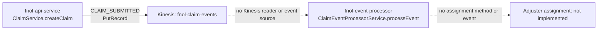
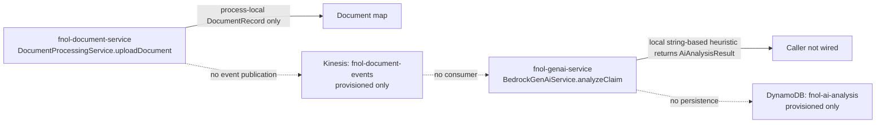
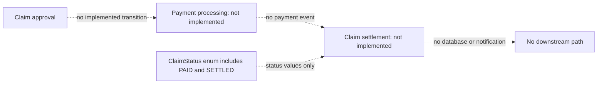
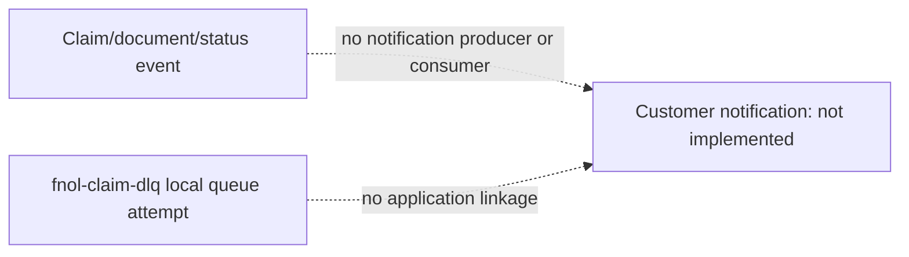
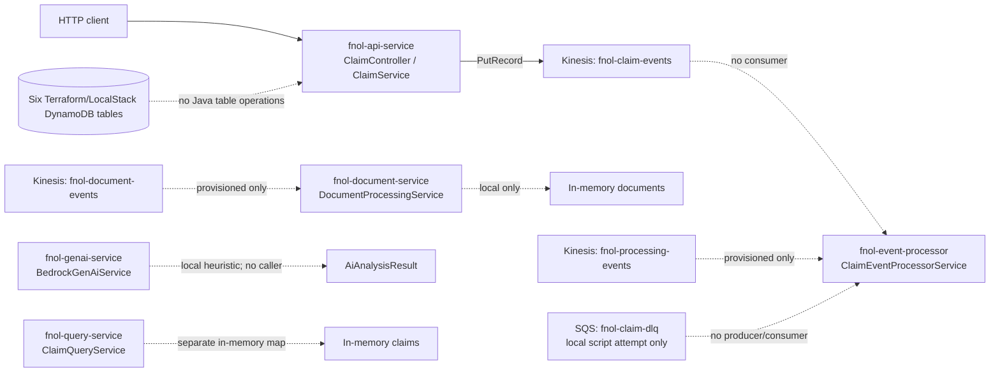

# FNOL End-to-End Architecture: Source-Verified Workflows

## Evidence boundary

All six services are modules in the `fnol-claim-event-ws` Maven repository. Diagrams mark a Java operation only when there is a source call path. Infrastructure-only resources and service methods without a trigger are shown as disconnected or labeled accordingly. A Mermaid diagram here is not a claim that the pictured workflow is deployed.

## A. FNOL submission to claim creation

```mermaid
sequenceDiagram
    actor Client
    participant C as fnol-api-service<br/>ClaimController.submitClaim
    participant S as ClaimService.createClaim
    participant K as KinesisClaimPublisher.publish
    participant Stream as fnol-claim-events
    Client->>C: POST /api/v1/claims<br/>ClaimSubmissionRequest
    C->>S: createClaim(request)
    S->>S: Create ClaimRecord; store in process-local map
    S->>S: Create CLAIM_SUBMITTED ClaimEventEnvelope<ClaimRecord>
    S->>K: publish(event, configured stream)
    K->>Stream: PutRecord<br/>partition key = claimId<br/>data = type|claimId|timestamp
    Stream-->>K: synchronous SDK result
    K-->>S: return
    S-->>C: ClaimRecord
    C-->>Client: HTTP 200
```

**Source references:** `fnol-api-service/src/main/java/com/fnol/api/controller/ClaimController.java`, `submitClaim`; `fnol-api-service/src/main/java/com/fnol/api/service/ClaimService.java`, `createClaim`; `fnol-api-service/src/main/java/com/fnol/api/service/KinesisClaimPublisher.java`, `publish`; stream configuration in `fnol-api-service/src/main/resources/application.yml`.

The full envelope is created in memory, but the publisher sends only `eventType|claimId|timestamp`, not the DTO payload or event ID. The claim is not written to DynamoDB.

## B. Claim creation to adjuster assignment



`ClaimEventProcessorService.processEvent` can mark an in-memory status as `VALIDATED` for a `CLAIM_SUBMITTED` envelope, but no Kinesis consumer invokes it. There is no policy lookup, adjuster assignment service, or assignment event.

## C. Damage assessment and GenAI processing



`DocumentProcessingService.uploadDocument` is service logic without a REST controller or external trigger in this module. `BedrockGenAiService.analyzeClaim` is a heuristic implementation; it does not call Amazon Bedrock, does not have a controller, and is not invoked by the document or event processor module. The `fnol-document-events` stream and `fnol-ai-analysis` table have no connected Java path.

## D. Settlement calculation and claim approval

```mermaid
flowchart LR
    U[Caller] -->|PATCH /api/v1/claims/{claimId}/status| C[ClaimController.updateClaimStatus]
    C --> S[ClaimService.updateStatus]
    S --> M[In-memory ClaimRecord update]
    S --> E[In-memory CLAIM_STATUS_UPDATED envelope]
    E -. not published .-> K[Kinesis streams]
    X[Settlement calculation] -. absent .-> A[Approval workflow]
```

The API endpoint accepts a status value from the caller and updates its in-memory map. `ClaimService.updateStatus` appends an event to the in-memory history but does not call the Kinesis publisher. There is no settlement calculation or separate approval operation.

## E. Payment processing and claim settlement



`ClaimStatus` includes `PAID` and `SETTLED`, but no payment processor, settlement calculation, payment provider integration, or settlement consumer was found.

## F. Customer notifications



No notification service/provider, email/SMS dependency, SQS listener, or notification event was found. The local queue is not connected to notifications.

## G. Replay administration

```mermaid
flowchart LR
    A[Caller] -->|GET /api/v1/claims/{claimId}/events| C[ClaimController.getClaimEvents]
    C --> S[ClaimService.getClaimEvents]
    S --> M[Process-local event list]
    R[Replay administration] -. no endpoint, Kinesis reader, or republisher .-> K[Kinesis: fnol-claim-events]
```

The API exposes event-history retrieval from process memory. This is not a replay command: there is no Kinesis read/checkpoint, replay offset, admin authorization/action, or event re-publication path.

## Workflow status matrix

| Requested module | Actual entry point / method | AWS or data operation confirmed | Outcome |
|---|---|---|---|
| FNOL submission | `ClaimController.submitClaim` → `ClaimService.createClaim` | Kinesis `PutRecord` to `fnol-claim-events`; claim/event in process memory | Implemented, but message is reduced and no consumer is wired |
| Policy validation | None | None | Not implemented |
| Claim creation | `ClaimService.createClaim` | Process-local claim map | Implemented in memory; no DynamoDB write |
| Adjuster assignment | None | None | Not implemented |
| Damage assessment | `BedrockGenAiService.analyzeClaim` (not invoked) | Local heuristic only | Method exists, workflow is disconnected |
| Settlement calculation | None | None | Not implemented |
| Claim approval | `ClaimController.updateClaimStatus` / `ClaimService.updateStatus` | Process-local map and event list | Generic manual status update, not approval workflow; event not published |
| Payment processing | None | None | Not implemented |
| Claim settlement | None | None | Not implemented; enum value alone |
| Customer notification | None | None | Not implemented |
| Replay administration | `ClaimController.getClaimEvents` | Process-local event list read | Event retrieval only; replay not implemented |

## Service and process topology



The five service applications have separate Spring Boot entry points, but there is no service-to-service REST client or event wiring between them. Docker Compose starts only the API and query service alongside LocalStack. The query module's `ClaimQueryService.saveClaim` is not called from the API.

## Independent execution and delivery semantics

- Services can be launched as processes independently; business workflows are not independent end-to-end because event handoffs are missing.
- The API handles request flow synchronously and makes a synchronous SDK `putRecord` call.
- No Kinesis or SQS consumer runs independently or in parallel.
- No Kinesis-to-SQS or SQS-to-Kinesis integration exists.
- Claim/event/document/analysis/query maps are local to each process; one module cannot observe another module's map.
- A `claimId` Kinesis partition key is set, but no reader/checkpoint logic is configured. No exactly-once semantics or end-to-end ordering contract is implemented.
- No deduplication/conditional writes use `eventId`; no application-managed retry, DLQ handling, or replay is present.

## Infrastructure alignment

The LocalStack and Terraform definitions provide three named Kinesis streams and six DynamoDB tables. Terraform also provides a generic IAM role/policy and CloudWatch alarms/log group. However, Java configuration only consumes `KINESIS_STREAM_FNOL` for `fnol-claim-events`; there are no Java table-name, queue-name, consumer-group, checkpoint, or Lambda settings.

`docker-compose.yml` excludes SQS from LocalStack's configured `SERVICES`, while the initialization script attempts SQS queue creation. The Terraform DLQ settings are not consumed by a queue resource. See [AWS-KINESIS-FLOW.md](AWS-KINESIS-FLOW.md), [AWS-SQS-FLOW.md](AWS-SQS-FLOW.md), and [DYNAMODB-TABLE-OWNERSHIP.md](DYNAMODB-TABLE-OWNERSHIP.md) for per-resource details.
