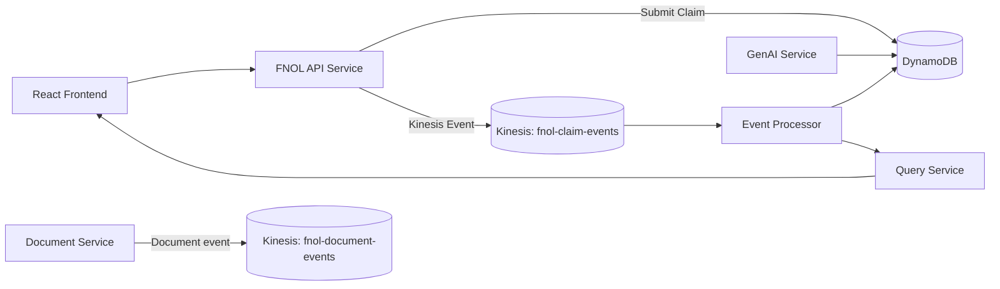

# FNOL Architecture Overview

## Components

- FNOL API Service: receives REST requests and publishes claim-submitted events.
- Event Processor: consumes Kinesis events, updates claim status, and persists processing metadata.
- Document Service: manages metadata for uploaded claim documents and emits document events.
- GenAI Service: categorizes claim content and assesses risk indicators.
- Query Service: serves dashboard summaries and claim lookups.
