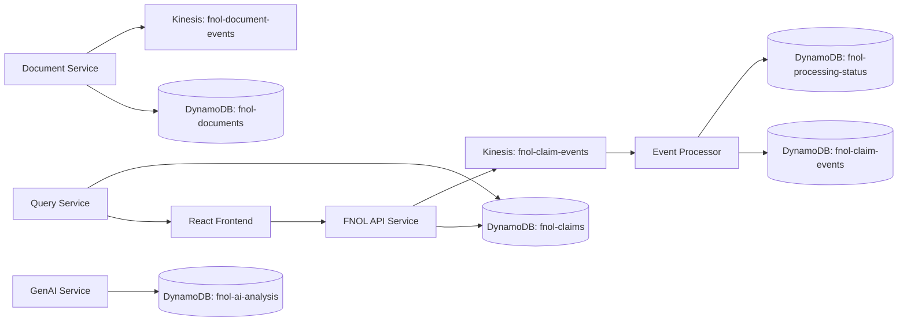

# FNOL Terraform Infrastructure

This directory contains the AWS infrastructure definitions for the existing FNOL application. The Terraform configuration is intentionally aligned to the actual Java service contracts and LocalStack setup already present in this repository.

## Resource alignment

The implementation matches the application behavior already in the repo:

- Kinesis stream: `fnol-claim-events` for claim submission events
- Kinesis stream: `fnol-document-events` for document processing actions
- Kinesis stream: `fnol-processing-events` for processing workflow events
- DynamoDB tables: `fnol-claims`, `fnol-claim-events`, `fnol-documents`, `fnol-processing-status`, `fnol-ai-analysis`, `fnol-processed-events`

## Architecture diagram



## Terraform structure

```text
terraform/
  versions.tf
  providers.tf
  main.tf
  variables.tf
  outputs.tf
  locals.tf
  data.tf
  modules/
    kinesis/
    dynamodb/
    iam/
    monitoring/
  environments/
    dev/
    test/
    prod/
  scripts/
  README.md
```

## Local validation

Run the PowerShell helpers from the script directory or from the environment folder:

```powershell
cd D:\GenAi-Projects\fnol-claim-event-ws\infrastructure\terraform\scripts
./validate.ps1 -Environment dev
./terraform-plan.ps1 -Environment dev
```

## Deployment notes

- Do not run `terraform apply` without first reviewing the plan.
- Remote state is intentionally configured to use an S3 backend with state locking; create the state bucket separately.
- LocalStack development should use `use_localstack = true` or `AWS_ENDPOINT_URL` in the Java services, not production-grade AWS credentials.

## Important guardrails

- The Terraform configuration reflects the existing repository architecture and LocalStack scripts.
- The data model is intentionally constrained to the existing FNOL schema used by the application and scripts.
- No Kafka resources are introduced.
